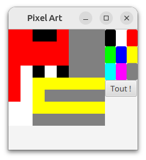

# Modèle Vue Contrôleur en équipe

Dans ce TP, nous allons revoir le MVC, mais cette fois en équipe, 
en mettant en évidence l'intérêt du découplage et de git pour travailler à plusieurs.

## Pixel Art

L’exercice consiste à réaliser une petite application graphique, à plusieurs en parallèle, 
avec votre groupe de projet.
L'application doit permettre à ses utilisatrices et utilisateurs 
de réaliser des dessins en pixel art.

Le cahier des charges de l'application est simple et peut se réduire 
aux cas d'utilisation suivants :

1. changer la couleur du pinceau 
2. colorier tous les pixels d'une même couleur 
3. colorier un pixel d'une couleur
4. redimensionner le dessin

## Règles du jeu

Nous vous imposons des contraintes qui sont existantes dans certains projets du « monde réel » (ex : projets open-source) et qui ont pour but de vous donner une expérience des commandes git.

 - Vous ne pouvez pas communiquer oralement (situation courante d'un projet en groupe à distance);
 - Deux membres d’un groupe ne peuvent pas être voisins (pour éviter d'être tenté de déroger au point précédent) ;
 - Vous effectuerez la série de commandes *pull*, *add*, *commit*, *push* après chaque portion de code réalisée (un test, 1 ou 2 méthodes, la base d'une classe, etc.) en veillant à ne pas pousser de code qui ne compile pas ;
 - Des conflits git vont se produire, on va ici essayer de les limiter mais savoir y faire face fait partie de l’exercice.

## Mise en place

1. La personne de l'équipe dont le prénom est le 1er dans l'ordre alphabétique (et uniquement elle) crée une bifurcartion du présent projet (*fork*), de visibilité privée.
2. Cette même personne octroie les droits de *owner* du projet aux autres membres présents et le rôle de *reporter* à l'enseignant.e de TP.
3. **Tous** les membres du projet clônent **sur leur session** le projet **du groupe** (le *fork*), de manière à pouvoir faire des push par la suite sur le bon dépôt distant sans étape de configuration.

## Répartition du travail

Votre n+1 (votre prof de R304) a organisé la répartition du travail.

La personne de l'équipe dont le prénom est le dernier dans l'ordre alphabétique modifie le tableau suivant sur le dépôt distant, en remplaçant les prénoms par ceux des membres présents, dans l'ordre alphabétique.
Chaque membre prend connaissance de son rôle principal durant ce TP.

| Fonctionnalité                | Tests | Modèle | Vue   | Contrôleur + Main | Volant * |
|-------------------------------|-------|--------|-------|-------------------|----------|
| Changer la couleur du pinceau | Jules |  Ophiuchus | Shafi | Youssef           |   |

\* uniquement dans le cas d'un groupe de 5, la personne à ce rôle peut aller voir les 4 autres, faire l'intermédiaire, aider, coordonner, elle passe au rôle suivant une fois la fonctionnalité terminée

## Architecture du projet et périmètres de travail

Au premier abord, il peut paraître compliqué de s'atteler aux différentes tâches simultanément.
Cependant, l'approche modulaire inhérente au MVC va nous permettre de limiter les conflits et dépendances.
Sont fournis par votre responsable : 

- la classe principale **App**
- dans le sous-paquetage modele,
  - l'enum **CouleurPixel** fournie
  - le squelette de la classe **DessinPixel**, vide à ce stade
  - côté répertoire test : la classe de test, vide à ce stade, exemples mis à part
- dans le sous-paquetage vue,
  - l'interface **DessinPixelObservateur**, qui indique les méthodes que doivent fournir les objets qui observent le modèle
  - la classe **DessinPixelVue**, qui va implémenter cette interface et être un *Stage*
- dans le sous-paquetage controleur,
  - l'interface **DessinPixelControleur**, qui indique les évènements à gérer et qu'il s'agira d'implémenter

## 1ère fonctionnalité : changer la couleur du pinceau

(celle sélectionnée par l'utilisateur préalablement, ou le blanc par défaut)

Essayez d'identifier clairement ce que vous avez à faire, faîtes le, n'oubliez pas de pousser votre code régulièrement.

## 2ème fonctionnalité : colorier tous les pixels d'une même couleur

Si vous avez terminé la partie précédente, vous pouvez :

1. récupérer ce qui a été fait par vos camarades jusque là
2. regarder si ce que vous avez fait est compatible ou non avec les autres parties qui interagiraient avec la votre
3. modifier ce qui n'irait pas si ça vient de vous et prévenir sinon
4. pousser vos changements
5. passer à la 2ème fonctionnalité en décalant vers le rôle suivant
   (faîtes le sur le fichier avec vos prénoms si ça n'est pas déjà le cas) :

Dans le cas présent, on change les rôles après chaque fonctionnalité, pour des motifs pédagogiques
(on éviterait si on cherchait uniquement la productivité à court terme)

| Fonctionnalité | Tests   | Modèle | Vue       | Contrôleur + Main | Volant * |
|----------------|---------|--------|-----------|-------------------|----------|
| Colorier tout  | Youssef | Jules  | Ophiuchus | Shafi             |          |

Il s'agit désormais d'implémenter le code nécessaire à la fonction qui permettra de colorier tous les pixels de la couleur du pinceau.

## 3ème fonctionnalité : colorier un pixel d'une couleur

Suivez le même principe que précédemment :

| Fonctionnalité    | Tests | Modèle | Vue | Contrôleur + Main | Volant * |
|-------------------|-------|--------|-----|-------------------|----------|
| colorier un pixel |Shafi|Youssef|Jules|Ophiuchus|          |

## 4ème fonctionnalité : redimensionner le dessin

Suivez le même principe que précédemment :

| Équipe/Rôle    | Tests | Modèle | Vue | Contrôleur + Main | Volant * |
|----------------|-------|--------|-----|-------------------|----------|
| redimensionner |       |        |     |                   |          |

Jusqu'ici, on ne peut réaliser de dessins que sur une base d'une taille fixée (par ex. 8x8).
Le nouveau cas d'utilisation demandé par le client consiste à pouvoir redimensionner notre dessin en cours de réalisation.
Dans le cas d'un élargissement, les pixels supplémentaires seront ajoutés en bas à droite.
Dans le cas d'une réduction, les pixels rognés seront ceux en bas à droite.

## Fonctionnalités bonus (pour les plus rapides)

- exportation du dessin en png via un bouton

| Équipe/Rôle | Tests | Modèle | Vue | Contrôleur + Main | Volant * |
|-------------|-------|--------|-----|-------------------|----------|
| exportation |       |        |     |                   |          |

- vue supplémentaire en taille réelle et sans contrôleur
- vos idées

## Marre de saisir votre mot de passe ? Vive les clés ssh
Si ça n'est pas déjà fait, pensez à utiliser les clés ssh pour vous authentifier sans avoir à saisir identifiants et mot de passe à chaque fois. Pour ce faire, aller sur la [page de paramètrage utilisateur concernant les clés ssh](https://gitlab.univ-lille.fr/-/user_settings/ssh_keys), cliquez sur *Ajoutez une nouvelle clé* et suivez l' [aide proposée](https://gitlab.univ-lille.fr/help/user/ssh#see-if-you-have-an-existing-ssh-key-pair).
