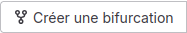
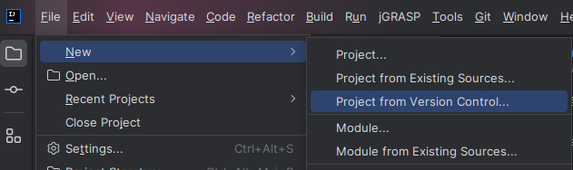
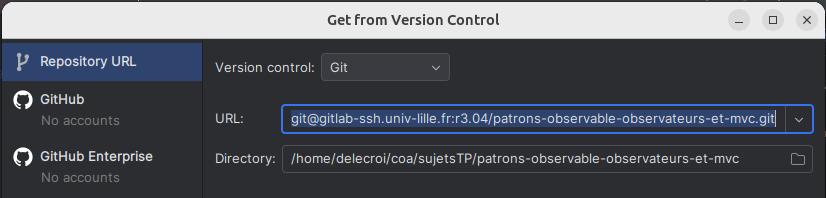
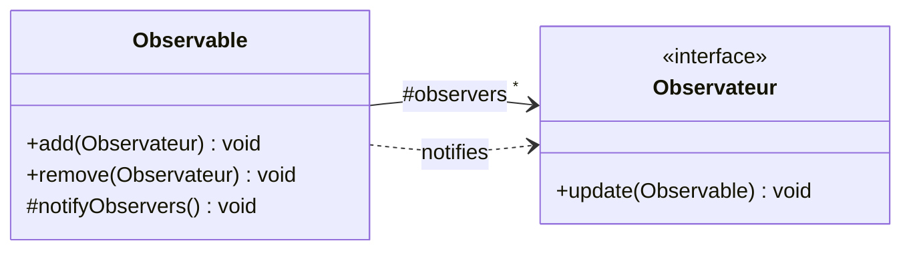
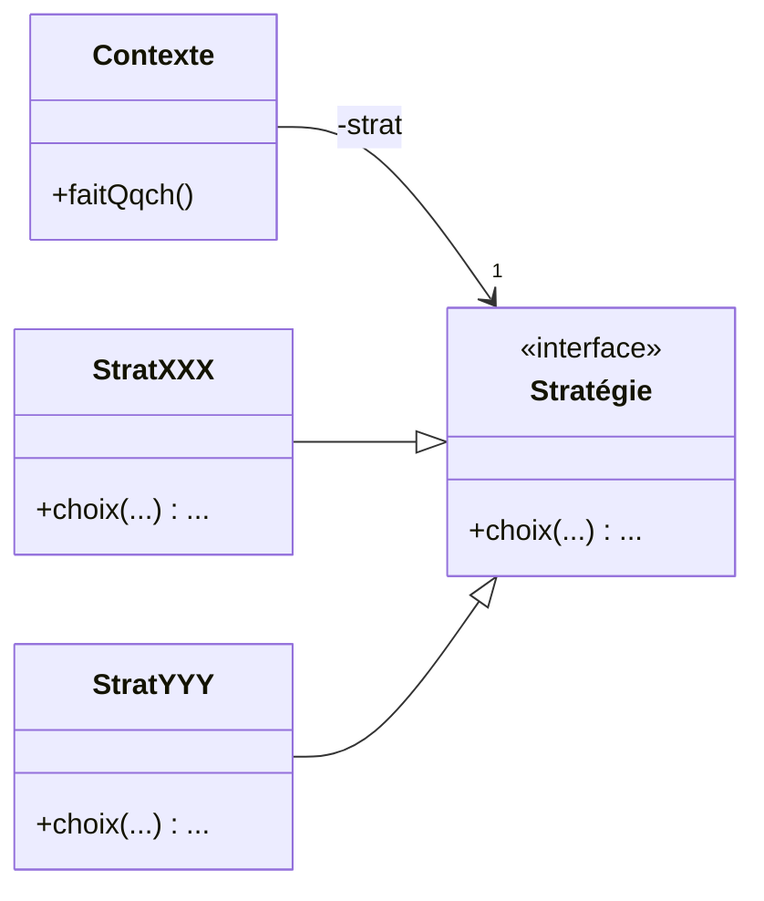

# TP2 : Patrons de conception Observable-Observateurs


## Introduction
Dans ce TP vous allez mettre en oeuvre deux patrons de conception :

1. Observable - Observateurs
2. Stratégie

L'objectif est de comprendre et retenir le principe de ces patrons de conception et de savoir les appliquer de manière autonome.

Pour commencer, vous allez récupérer le contenu de dépôt afin de le compléter au fur et à mesure de ce TP.
Pour ce faire, vous allez commencez par réaliser un fork

### Fork

Sur ce dépôt, en plus du sujet (ce document), vous trouverez une organisation en paquetages et une première base des classes qu'ils contiennent.

Créez une bifurcation (*fork* en anglais) de ce projet de manière à en avoir une copie sur un dépôt distant qui vous appartienne et sur lequel vous pourrez faire des modifications sans altérer l'original.

<a></a>

### Cloner depuis l'environnement de développement intégré

Pour réaliser ce TP (comme les suivants), nous vous conseillons fortement d'utiliser IntelliJ comme Environnement de Développement Intégré (*IDE* en anglais).

Il est possible de créer directement un nouveau projet à partir d'IntelliJ :
1. dans le menu projet d'IntelliJ, choisissez *Get from Version Control...*
   <a></a>

2. une fenêtre s'ouvre dans laquelle vous pouvez coller l'URL du dépôt distant à cloner :
   <a></a>

Après avoir appuyer sur le bouton **Clone**, le dépôt est cloné localement et le projet directement ouvert sur intelliJ.


## Le patron Observateurs / Observable

La figure suivante vous présente le patron Observateurs / Observable.
L’idée est qu’un ou plusieurs observateurs peuvent s’inscrire auprès d’un Observable et être avertis d’évènements qui se produisent sur ce dernier.
La méthode « update() » des Observateurs est déclenchée par l’Observable chaque fois qu’il veut prévenir d’un évènement.
Il utilise pour ça sa propre méthode « notifyObservers() ».


Pour rappel :



## Une roulette de casino

On souhaite simuler une table de roulette au casino, sans s'occuper de la partie mise et gains.
On met en oeuvre un scénario avec :

- 1 Observable : une roulette qui sort un numéro au hasard à chaque tour entre 0 et 49.
- 2 Observateurs :
   - un annonceur qui affiche sur la sortie standard le numéro sorti, sous la forme *Annonceur : <numéro>*
   - un joueur nommé *Hal* qui parie toujours sur le numéro 42 et qui affiche "Gagné !" si le numéro en question est tombé et "Zut, perdu !" dans le cas contraire.

**Complétez l'UML de la feuille distribuée** avec les informations ci-dessus et en pensant à ajouter la méthode qui change l'état de l'observable.

Voici un extrait de la trace d'exécution qu'on souhaiterait par exemple obtenir :
```
---La roulette s'arrête---
Annonceur : 17
Hal : Zut, perdu !
---La roulette s'arrête---
Annonceur : 42
Hal : Gagné !
...
```
À noter qu'une exécution dans laquelle *Hal* réagirait avant que l'annonceur dise le numéro serait tout aussi valable. Les différents acteurs réagissent ici au numéro gagnant de la roulette.

Pour appliquez le patron Observable-observateurs, vous devrez notamment :

- dans **Roulette**, encapsuler une liste d'observateurs et les notifier après chaque lancer.
- dans l'interface **Observateur**, ajouter la signature de méthode adéquate.
- dans **les classes correspondants aux observateurs**, implémenter cette interface et écrire le code requis pour arriver au scénario attendu.
- dans la classe **Main**, implémentez un scénario dans lequel une roulette effectue 10 lancers (il ne devrait y avoir qu'une instruction à l'intérieur de la boucle !).

Une fois ceci fait, lancer votre main pour voir s'il produit le comportement attendu.

**Modifiez votre code** de manière à avoir désormais un 2ème joueur, Djaouad, qui parie lui aussi sur son numéro fétiche, le 7. Aucune nouvelle classe ne devrait être créée.


### Nouveaux joueurs, nouvelles stratégies

On veut désormais ajouter d'autres joueuses et joueurs à notre simulation. On considère que toutes et tous réagissent de la même manière que Hal lorsque leur numéro sort et dans le cas contraire. Par contre, chacun.e a un nom et sa propre stratégie pour décider du numéro sur lequel parier  :
- Alice parie sur le numéro 0 au 1er tour, le numéro 1 au 2ème tour et ainsi de suite.
- Moussa alterne entre deux numéros : 20 et 10

**Revoyez la conception** de votre logiciel en appliquant le patron de conception Stratégie rappelé ci-dessous. 
**Montrez votre UML pour validation** avant d'**implémenter**.



Voici un exemple d'exécution attendu :
```
---La roulette s'arrête---
Annonceur : 20
Hal : Zut, perdu !
Djaouad : Zut, perdu !
Alice : Zut, perdu !
Moussa : Gagné !
---La roulette s'arrête---
Annonceur : 20
Hal : Zut, perdu !
Djaouad : Zut, perdu !
Alice : Zut, perdu !
Moussa : Zut, perdu !
---La roulette s'arrête---
Annonceur : 2
Hal : Zut, perdu !
Djaouad : Zut, perdu !
Alice : Gagné !
Moussa : Zut, perdu !
```

### Martingale

On souhaite mettre en place une nouvelle stratégie qui consiste à parier sur le même numéro que le dernier qui a été tiré. Pour le 1er tour, on pourra considérer qu'on pariera sur le 0.

**Proposez une solution de conception et implémentez-là après validation.**

## Y a plus de saisons !

On veut cette fois simuler les comportements de différents animaux qui réagissent à la météo.

On considère que la Météo change aléatoirement et que les animaux y réagissent chacun à leur manière.

| Météo           | Soleil      | Pluie                                  | Nuage                    |
|:----------------|:------------|:---------------------------------------|:-------------------------|
| Enfant          | joue dehors | joue dans la boue                      | observe les nuages       |
| Chat            | se prélasse | regarde à l'intérieur                  | se balade dans le jardin |
| Vacancière      | bronze      | sort son parapluie                     | joue au molkky           |
| Oiseau          | chante      | se réfugie dans l'arbre                | mange dans l'herbe       |

On veut réaliser un programme qui simule ces différents comportements. Voici un exemple d'exécution :

```
---Météo : Pluie---
Un enfant joue dans la boue
Un chat regarde à la fenêtre
Une vacancière sort son parapluie
Un oiseau se réfugie dans l'arbre
...
```


À quel patron recourir ? **Faîtes une proposition sous forme sous forme d'UML**.
Une fois la proposition validée, **implémentez**-la.

Bonus : Faites en plus en sorte que s'il y a un chat qui se balade dans le jardin, l'oiseau se réfugie dans l'arbre.