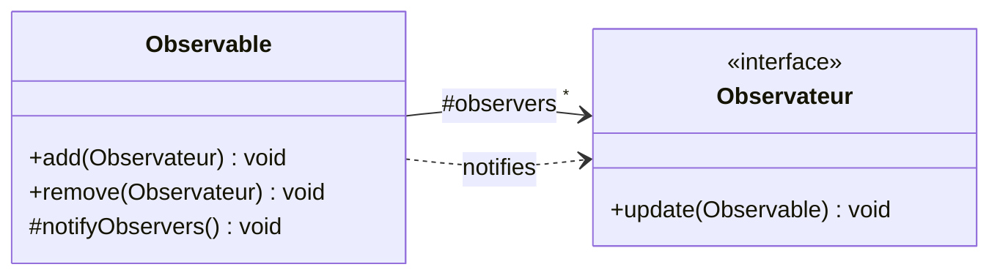
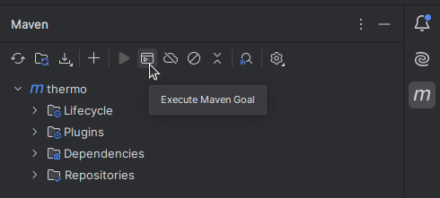
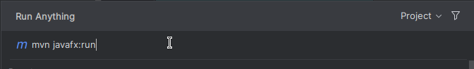
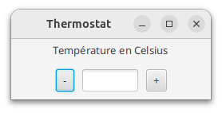

# Modèle Vue Contrôleur (MVC) : l'exemple du thermostat

## Objectif MVC

Dans ce TP, l'objectif principal est de comprendre et savoir mettre en oeuvre le patron de conception *M*odèle *V*ue *C*ontrôleur.
Celui-ci repose sur Observable-Observateurs, vu la semaine dernière, et sert généralement dans l'interaction avec un utilisateur.

Pour rappel :



La **Vue** est donc ce qui gère l'affichage de l'état du **Modèle** à l'écran.
Le **Contrôleur** s'occupe lui d'opérer les actions sur le modèle à partir des actions de l'utilisateur.

Pour rappel, le modèle :
- est indépendant des vues. Il ne doit contenir aucun « import javafx » ;
- contient les données nécessaires à l'application ;
- contient aussi des comportements possibles sur ces données (mais sans s'occuper de l'affichage)

Dans ce TP nous allons mettre en oeuvre le patron MVC pour une application très simple : un thermostat.

## Mise en place 

Pour commencer, vous allez commencez par réaliser un *fork*, c'est-à-dire une bifurcation, une copie sur gitlab de ce dépôt qui vous appartienne et sur laquelle vous pourrez faire des modifications sans altérer l'original.
Pour ce faire, il y a un bouton en haut de cette page intitulé *fork* ou *bifurcation* selon la langue de préférence votre compte gitlab (on le précise car la semaine dernière certains sont passés à côté).

<a></a>

Une fois la bifurcation créée, vous pouvez le cloner en local, soit via la ligne de commande, soit via l'IDE comme le TP précédent.

Sur ce dépôt, en plus du sujet (ce document), vous trouverez une organisation en paquetages et une première base des classes qu'ils contiennent.

### Configuration IDE JavaFX
Ce TP sera aussi l'occasion de réviser vos connaissances en JavaFX.
Un *pom.xml* est fourni afin de vous faciliter la gestion des dépendances à JavaFX.

Cette partie du TP s'appuie sur la bibliothèque JavaFX (présente sur les machines de TP dans */home/public/javafx-sdk-17.0.2.* ).
Pour gérer cette dépendance et permettre la déployabilité du projet y compris sur d'autres machines, le choix a été fait de recourir à *maven*. C'est le fichier *pom.xml* du dépôt qui décrit notamment les dépendances et plugins à résoudre.
Depuis *IntelliJ IDEA Community Edition*, vous verrez normalement sur la barre verticale à droite de l'écran un *m* (pour *maven*). Ce bouton permet d'ouvrir un volet offrant une vue sur les différents éléments du pom.xml ainsi que leur résolution ou non.

Vous pouvez d'ores et déjà lancer l'application avec la commande **javafx:run** pour vous assurer que tout fonctionne correctement,
Pour le moment, elle devrait afficher une fenêtre avec deux boutons inopérants à ce stade et un label.

<a></a>

<a></a>

<a></a>

## Application du MVC

Un thermostat dans sa plus simple expression est un appareil ayant une température désirée et régulant le chauffage pour que la température réelle l'atteigne.
On ne s'occupera bien sûr pas des capteurs et de la température réelle ici, ni du chauffage, mais seulement de pouvoir régler la température désirée.

### Modèle
On a donc un modèle et une interface graphique (vue + contrôleur) très simple.

On va réaliser une première version de l'application, dans laquelle on souhaite pouvoir :
- voir la valeur désirée du thermostat
- changer cette valeur par une autre en l'incrémentant ou la décrémentant d'1 degré à la fois.


Un **UML** vous est fourni, 
- **remplissez le nom de la classe** à laquelle correspond le modèle de l'application.
- **ajouter les attribut(s) et méthode(s)** qu'il devrait contenir.
- **demander à votre enseignant.e de le valider**

S'agissant d'une implémentation MVC, les communications du modèle vers la vue (l'affichage) se font suivant le patron observable-observateurs.

Comme on le voit sur l'UML, le modèle va donc lors de ses changements notifier la ou les vues (affichages) qui l'observent.

**Implémentez votre modèle**.

### Vue et contrôleur

On s'intéresse à présent aux vues.
Une Vue est une classe qui implémente l'interface des observateurs de notre modèle et va donc se mettre à jour lorsqu'elle sera notifiée.

**Donnez un nom** à l'interface sur votre UML et **indiquez le nom d'une classe qui devra l'implémenter** (fournie sur le dépôt).
Note : l'autre implémentation de l'interface concerne la toute fin du TP. 

**Répercutez cette implémentation dans le code** en ajoutant la partie contrôleur à votre vue. 
Petit rappel d'IHM, on dispose d'une méthode *setOnAction* sur les boutons qui attend un gestionnaire d'évènements dans lequel on va indiquer le code à exécuter lorsque le bouton est actionné.
On peut typiquement faire une lambda
```java 
    boutonPlus.setOnAction(e -> {instructions});
```

À ce stade, que reste-t-il à faire pour que la vue soit effectivement parmi les observateurs du modèle ?
Ajoutez le code manquant dans la classe de la vue. 

Note : Puisqu'on fait plusieurs vues (fenêtres) dans ce TP, il est plus pratique de ne pas utiliser le <code>PrimaryStage</code> que la classe principale (qui hérite de Application) fournit dans la méthode <code>public void start(Stage primaryStage)</code>.
Il sera plus naturel que chaque vue créée sa propre instance de stage. 
Votre classe Main ne devrait donc que très peu évoluer, simplement une ligne de code supplémentaire pour chaque nouvelle vue

## Plusieurs vues

Avec une seule vue, ce patron peut sembler inutilement compliqué.
Mais si on a plusieurs vues (par exemple un thermostat à deux extrémités d'une grande pièce), l'utilisation de Observable-Observateur prend son sens.

**Rajoutez maintenant une nouvelle vue** (ou 2, ou 3) en créant simplement des nouveaux objets de la classe vue (une ligne Java).
Vérifiez que toutes les vues sont toujours synchronisées (affichent la même température désirée) grâce au MVC (et donc au mécanisme observable-observateurs).

**Que faut-il bien penser à faire lorsqu'on ferme la fenêtre correspondant à une vue ?**
La méthode qui correspond à cet évènement est ici *setOnCloseRequest*, on peut donc ici aussi ajouter le code pertinent comme précédemment :
```java 
    this.setOnCloseRequest(e -> {instructions});
```
### Contrôles différents

On souhaite désormais proposer en plus une interaction légèrement différente : appuyer sur les boutons fera varier la température de 0.1 degré.


La vue étant tout à fait identique, il serait dommage de recréer entièrement une nouvelle classe au code très similaire.
Une solution consiste à extraire le code du contrôleur afin de pouvoir choisir lequel brancher.
Ainsi, dans la gestion des évènements correspondant aux actions de l'utilisateur, plutôt que de directement aller toucher le modèle, on va déléguer cette taĉhe au contrôleur.
Au dos de votre feuille, **dessinez l'UML** de votre vue et des entités pour les deux contrôleurs différents.
Une fois celui-ci **validé** par votre enseignant.e vous pouvez l'**implémenter**.

### En mode...

On souhaite maintenant pouvoir choisir entre différents modes :
- jour : la température est alors réglée sur 18°, les boutons + et - n'ont plus d'effet
- nuit : la température est réglée sur 15°, les boutons + et - n'ont plus d'effet
- manuel : la température peut être modifiée comme précédemment


Réfléchissez à ce que cela va changer **dans le modèle**, **proposez une solution et implémentez-là**.

**Côté vue**, on va pouvoir utiliser une *ComboBox*, pour permettre le choix entre les différents modes via un menu déroulant.
Voici un exemple de code d'un tel menu déroulant avec les entiers 7, 42 et 404.

```java
    ComboBox<Integer> combo = new ComboBox<>();
    combo.getItems().addAll(7, 42, 404);
    //initialisation
    combo.setValue(42);
```
Les ComboBox étant génériques, on peut employer n'importe quel type, y compris celui par lequel vous aurez modélisé les modes.
Il faudra donc ajouter ce composant dans la HBox et gérer l'évènement déclenché lors d'un choix de l'utilisateur.
À noter qu'on peut récupérer la nouvelle valeur sur l'évènement via la méthode **getSource().getValue()** après avoir fait le transtypage nécessaire.

### Bonus : Vue différente

Créez une nouvelle vue utilisant un *Slider* pour afficher et modifier la température désirée.
On peut décider que les températures sont bornées entre -10.0 ⁰C et +30.0⁰C.
Bien sûr, les anciennes vues doivent continuer à fonctionner.


